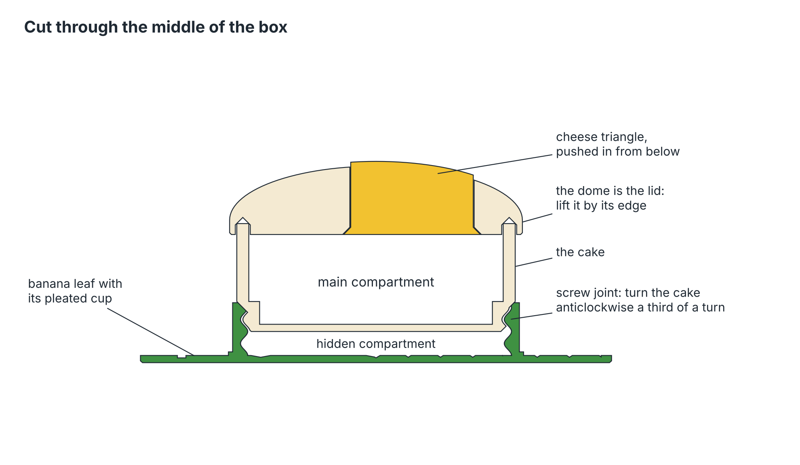
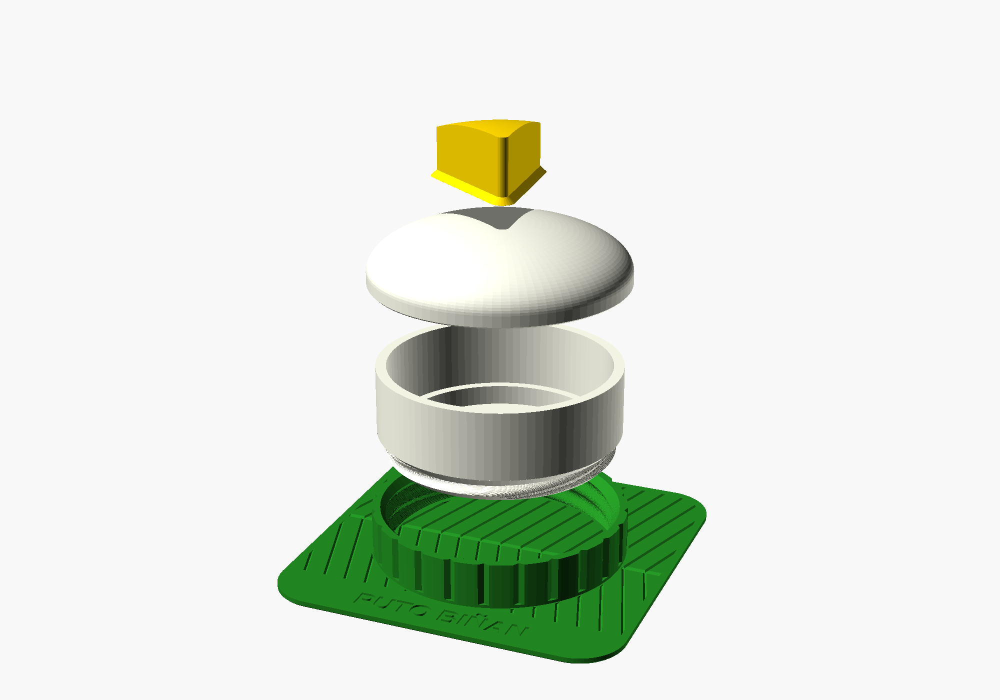

# Puto Biñan trinket box

A small round box that looks like a puto: a white domed cake with one triangular slice of cheese on top, sitting in a pleated cup on a banana leaf. The dome is the lid. The secret is underneath: the cake unscrews from the leaf, and the leaf's cup hides a second compartment.

| | |
|---|---|
| Outside | 68 × 68 × 34 mm |
| Main compartment | 42 mm across, 15 mm deep |
| Hidden compartment | 43 mm across, 4 mm deep (coins, a ring, a folded note) |

**Status: designed and checked by simulation, not yet printed.** Print one set and try the screw joint before a full plate.

## Opening it

- **Lid:** lift the dome by its edge, which overhangs the cake slightly.
- **Hidden compartment:** hold the leaf, turn the cake anticlockwise a third of a turn, and lift it off. Screw it back clockwise until it stops.

## Parts and print time

Four parts in three colours, each printed flat on the bed without supports.

| Part | Colour | Print time | Filament |
|---|---|---|---|
| `base` (leaf and cup) | green | 25 min | 11 g |
| `body` (cake) | white or cream | 12 min | 8 g |
| `lid` (dome) | white or cream | 12 min | 7 g |
| `cheese` (triangle) | yellow | 6 min | 2 g |
| **One box** | | **about 55 min** | **about 28 g** |
| **Four boxes** (`plate_green` 1 h 40, `plate_white` 1 h 35, `plate_yellow` 13 min) | | **about 3 h 30** | **about 110 g** |

Times and weights are slicer estimates for an Ender-3 V3 KE on its stock 0.20 mm Standard profile. They leave out heating and bed levelling.

## Print settings

- Stock **0.20 mm Standard** profile, PLA, no supports, no brim. Keep the orientation of the STL files.
- The top of the dome is nearly flat, so its layers show as fine rings. For a smoother dome, print the lids with thinner layers (the 0.12 mm profile, or adaptive layer height).
- A pale yellow filament looks most like the cheese in the real thing.

## Assembly

1. Push the cheese triangle up into the lid from below until its wider foot sits flush with the underside. If it is loose, add a drop of superglue.
2. Screw the cake into the leaf cup, clockwise, until it sits down on its cone.
3. Put the lid on.

## Adjusting the design

All dimensions are parameters at the top of `puto.scad` ([OpenSCAD](https://openscad.org)).

| If | Change |
|---|---|
| Screw joint too tight or too loose | `tclear` (0.4 mm) |
| Lid too tight or too loose on the cake | `rim_clear` (0.25 mm) |
| Cheese will not go into the lid, or rattles | `fit` (0.15 mm) |
| Different cheese shape or position | `cheese_pts` (the three corners) |
| Flatter or rounder cake | `dome_h` (9 mm) |
| Different text on the leaf | `label` |
| Deeper hidden compartment | `hidden_h` (4 mm) |

After a change run `python3 check.py`. It re-exports every STL and re-runs the checks (needs `openscad`, and `pip install trimesh manifold3d numpy networkx`).

## What the checks cover

`check.py` currently passes all of these:

- every part is a closed solid, sits flat on the bed, and no layer hangs out far enough to need supports
- nothing overlaps when the box is assembled
- the cake cannot be pulled straight off the leaf, and unscrews freely anticlockwise
- the lid lifts straight off the cake
- the cheese goes into the lid from below and cannot pull out through the top
- all three plates fit a 220 × 220 mm bed

Not covered: friction in the screw joint and real print tolerances. Only a test print answers those.

## Note for buyers

It is a trinket box shaped like food, not a food container. Printed plastic is not food-safe.
