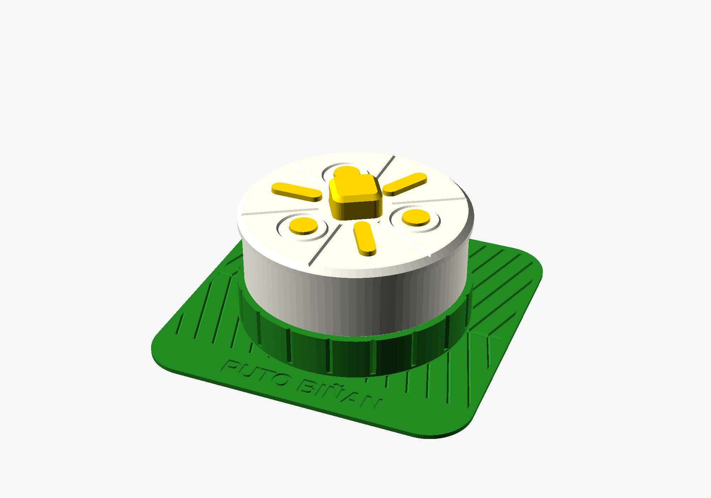
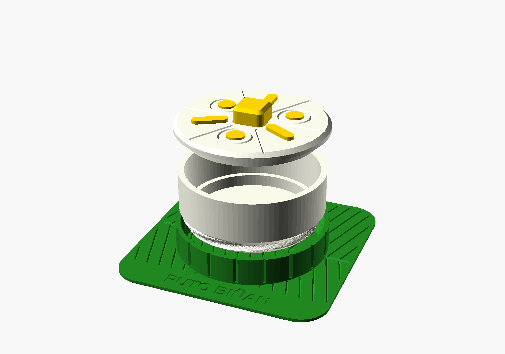

# Puto Biñan trinket box

A small round box that looks like a Puto Biñan on a banana leaf: white cake, cheese strips, salted-egg slices and a pat of butter. The lid lifts off by the butter pat. The secret is underneath: the cake unscrews from the leaf, and the leaf's cup hides a second compartment.

| | |
|---|---|
| Outside | 68 × 68 × 31 mm |
| Main compartment | 42 mm across, 17 mm deep |
| Hidden compartment | 43 mm across, 4 mm deep (coins, a ring, a folded note) |

**Status: designed and checked by simulation, not yet printed.** Print one set and try the screw joint before a full plate.

## Opening it

- **Lid:** lift it by the butter pat.
- **Hidden compartment:** hold the leaf, turn the cake anticlockwise a third of a turn, and lift it off. Screw it back clockwise until it stops.

## Parts and print time

Four parts in three colours, each printed flat on the bed without supports.

| Part | Colour | Print time | Filament |
|---|---|---|---|
| `base` (leaf and cup) | green | 23 min | 11 g |
| `body` (cake) | white or cream | 12 min | 8 g |
| `lid` | white or cream | 9 min | 4 g |
| `toppings` | yellow | 6 min | 2 g |
| **One box** | | **about 50 min** | **about 25 g** |
| **Four boxes** (`plate_green` 1 h 35, `plate_white` 1 h 20, `plate_yellow` 20 min) | | **about 3 h 15** | **about 100 g** |

Times and weights are slicer estimates for an Ender-3 V3 KE on its stock 0.20 mm Standard profile. They leave out heating and bed levelling.

## Print settings

- Stock **0.20 mm Standard** profile, PLA, no supports, no brim. Keep the orientation of the STL files.
- The lid prints upside down, so the top of the cake takes the texture of the print bed.
- An orange-yellow filament makes the egg yolks and butter look most like the real thing.

## Assembly

1. Press the yellow toppings plate into the lid from below, so the butter pat, cheese strips and yolks come through their holes. If it is loose, add a drop of superglue.
2. Screw the cake into the leaf cup, clockwise, until it sits down on its cone.
3. Put the lid on.

## Adjusting the design

All dimensions are parameters at the top of `puto.scad` ([OpenSCAD](https://openscad.org)).

| If | Change |
|---|---|
| Screw joint too tight or too loose | `tclear` (0.4 mm) |
| Lid too tight or too loose on the cake | `lip_clear` (0.25 mm) |
| Toppings will not go through the lid, or rattle | `fit` (0.15 mm) |
| No salted-egg slices wanted | `eggs = false` |
| Different text on the leaf | `label` |
| Deeper hidden compartment | `hidden_h` (4 mm) |

After a change run `python3 check.py`. It re-exports every STL and re-runs the checks (needs `openscad`, and `pip install trimesh manifold3d numpy networkx`).

## What the checks cover

`check.py` currently passes all of these:

- every part is a closed solid, sits flat on the bed, and no layer hangs out far enough to need supports
- nothing overlaps when the box is assembled
- the cake cannot be pulled straight off the leaf, and unscrews freely anticlockwise
- the lid lifts straight off the cake
- the toppings plate goes in from below and cannot pull out through the lid, so the butter pat lifts the lid
- all three plates fit a 220 × 220 mm bed

Not covered: friction in the screw joint and real print tolerances. Only a test print answers those.

## Note for buyers

It is a trinket box shaped like food, not a food container. Printed plastic is not food-safe.
