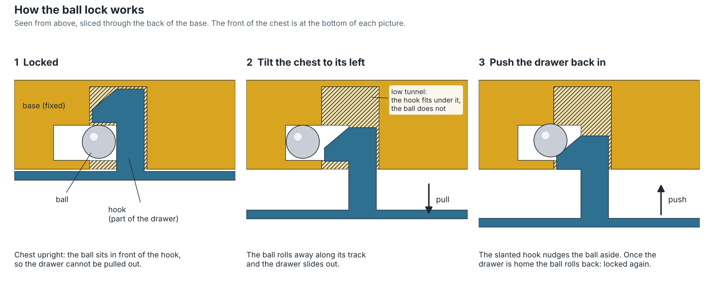

# Secret-drawer treasure chest ("baul")

A palm-sized chest for the night-market stand. The gold base looks like a plain plinth, but it is a hidden drawer held shut by a loose ball. Tilt the chest to its left and the base slides out of the front.

| | |
|---|---|
| Outside | 75 × 53 × 54 mm |
| Main compartment | 68 × 46 × 22 mm, plus the space in the lid |
| Secret drawer | 65 × 33 × 9 mm (coins, rings, SIM and SD cards, a folded note) |

**Status: designed and checked by simulation, not yet printed.** Print the plinth and drawer first and try the lock before printing the rest.

## Opening the secret drawer

1. Hold the chest facing you and tilt it to **its left** (left side down, about 45°, or lay it on its left side).
2. Keep it tilted and slide the base forward. There is a ribbed finger grip under the front, in the notch of the base.
3. To close, set the chest upright and push the drawer in until it stops. It locks by itself.

Tilt first, then pull: if you pull before tilting, the hook pinches the ball and it cannot roll.

## Parts

Everything prints in one colour per part, flat on the bed, without supports. Print `stl/plate_a.stl` in the chest colour and `stl/plate_b.stl` in the trim colour, or use the single-part files to fill a bed with several sets.

| Part | Colour | Qty | Print time | Filament |
|---|---|---|---|---|
| `body` | A (chest) | 1 | 36 min | 22 g |
| `lid` | A (chest) | 1 | 25 min | 15 g |
| `plinth` | B (trim) | 1 | 23 min | 13 g |
| `drawer` | B (trim) | 1 | 13 min | 8 g |
| `lid_strap` | B (trim) | 2 | 3 min each | 1 g each |
| `body_strap` | B (trim) | 2 | 1 min each | under 1 g |
| `lock_plate` | B (trim) | 1 | 1 min | under 1 g |
| **One chest** (plate A 1 h, plate B 40 min) | | | **about 1 h 40** | **about 61 g** |
| **Three chests** (two full beds: 3 h and 2 h) | | | **about 5 h** | **about 183 g** |

Times and weights are slicer estimates for an Ender-3 V3 KE on its stock 0.20 mm Standard profile (200 to 300 mm/s, 2 walls, 15 % infill). They leave out heating and bed levelling. Three sets of each colour fit on one 220 × 220 mm bed.

Hardware per chest:

- 1 ball, 6 mm: steel ball, or an airsoft BB. For a 1/4" (6.35 mm) bicycle bearing ball set `ball_d = 6.35` and re-export.
- 2 hinge pins: 18 mm lengths of 1.75 mm filament.
- 2 screws M3 × 10, pan head. Or superglue instead.
- Superglue for the straps and the lock plate.

## Print settings

- Ender-3 V3 KE: the stock **0.20 mm Standard** profile in Creality Print or OrcaSlicer, with PLA and the 0.4 mm nozzle. It uses 2 walls and 15 % infill, which is enough here.
- No supports and no brim. Keep the orientation of the STL files.
- The lid has a 24 mm bridge across its inside ceiling. The slicer may warn about a long bridge; leave supports off and run the part fan at 100 %.
- A squashed first layer makes the drawer tight. The parts have a small chamfer at the bottom for this, but if the drawer still drags, raise the nozzle slightly or turn on elephant-foot compensation.

## Assembly

1. Slide the drawer into the plinth. It should move freely and click lightly near the end. Take it out again.
2. Drop the ball into the slot at the back of the plinth.
3. Try the lock now, before closing it up: push the drawer in, check it will not pull out, then tilt left and slide it out.
4. Put the body on the two pegs. Fix it with the two M3 screws from underneath. If gluing instead, put small dots on the pegs and the side walls only, and keep glue away from the ball slot.
5. Hold the lid in place and push a filament pin through each hinge from the outside. The pin grips in the body knuckles and turns freely in the lid. Trim it flush.
6. Glue the two arched straps into the lid grooves, the two flat straps into the body grooves, and the lock plate into its recess.

The lid opens to about 108° and stays open. The keyhole plate is decoration only, which also makes it a decoy.

## Adjusting the design

All dimensions are parameters at the top of `chest.scad` ([OpenSCAD](https://openscad.org)).

| If | Change |
|---|---|
| Drawer too tight or too loose | `cl` (0.3 mm per side) |
| Click too strong, or not wanted | `detent` (0.5; 0 removes the bumps) |
| Different ball | `ball_d` |
| Hinge pin too tight or too loose | `pin_tight`, `pin_loose` |
| Lid should stop earlier or later | `heel` |
| Different size | `W`, `D`, `Hb`; keep `D` at 44 or more, the lock needs the depth |

After any change run `python3 check.py`. It re-exports every STL and re-runs the checks (needs `openscad`, and `pip install trimesh manifold3d numpy`).

## What the checks cover

`check.py` moves the real meshes through their motions and looks for collisions. The current design passes all of these:

- every part is a closed solid, sits flat on the bed, and both plates fit a 220 × 220 mm bed
- with the chest closed, no two parts overlap
- the lid swings freely, stops against the body at about 108°, stays open, and the chest does not tip backwards
- the drawer slides out 45 mm with nothing in the way
- chest upright: the ball holds the drawer after 1.4 mm of play
- chest tilted left: the ball rolls clear and the drawer comes out
- closing: the hook pushes the ball aside without jamming and the drawer is locked again

Not covered: friction, real print tolerances, and how reliably the ball rolls on a printed surface. Only a test print answers those.

## Safety

The ball is enclosed once the body is screwed on, so there are no loose small parts in normal use. Still, sell it as not suitable for children under 3.
