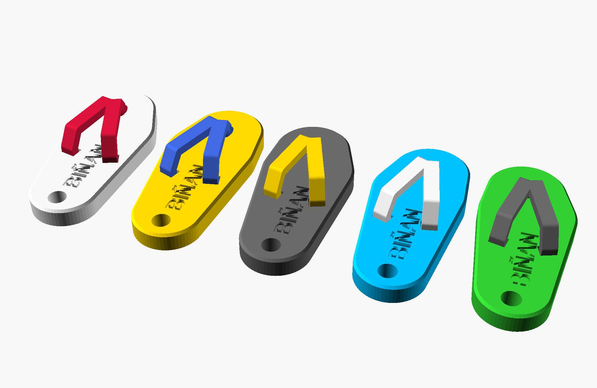
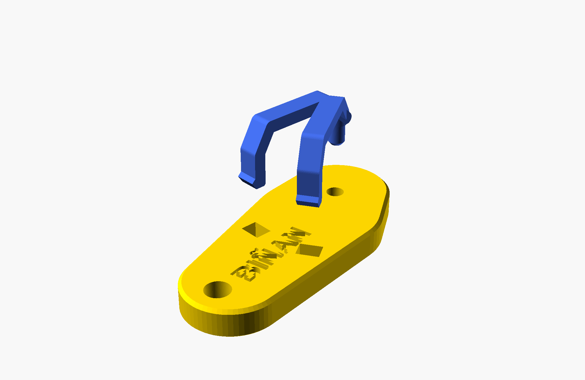

# Tsinelas keychain

A flip-flop keychain for the night-market stand, a nod to Biñan's footwear trade. The sole and the strap are separate one-colour prints that click together, so customers can pick their own colour combination and you assemble it in front of them.



| | |
|---|---|
| Size | 52 × 23 × 12 mm |
| Parts | sole + strap, left and right feet |
| Text | "BIÑAN" pressed into the sole (can be any short name) |
| Key ring | 4.5 mm hole in the heel |

**Status: designed and checked by simulation, not yet printed.** Print the fit test below before a full plate.

## Parts and print time

| | Print time | Filament |
|---|---|---|
| One sole | 8 min | 3.3 g |
| One strap | 4 min 30 | 0.6 g |
| **One keychain** | **about 12 min** | **about 4 g** |
| `plate_soles.stl` (12 soles: 6 left, 6 right) | 1 h 35 | 40 g |
| `plate_straps.stl` (12 straps) | 30 min | 8 g |
| **12 keychains** | **about 2 h** | **about 47 g** |

Times and weights are slicer estimates for an Ender-3 V3 KE on its stock 0.20 mm Standard profile. They leave out heating and bed levelling. You also need one split ring or ball chain per keychain.

## Print settings

- Stock **0.20 mm Standard** profile, PLA, no supports. Keep the orientation of the STL files: soles print right way up, straps print upside down.
- Straps stand on two narrow bars, so the slicer may warn about low bed adhesion. If any come loose, add a 3 mm brim to the straps only.
- For a striped rubber-slipper look, add a filament change part-way up the sole (for example at 3 mm).

## Fit test first

The click depends on your printer's tolerances, so tune it on a small piece before printing a plate.

1. Print `stl/fit_test.stl` and one `stl/strap_right.stl` (about 10 minutes together).
2. Press the strap into the three holes. Both legs should click in with firm thumb pressure.
3. Pull on the strap. It should stay put.

| If | Change in `tsinelas.scad` |
|---|---|
| Legs will not go in, or need too much force | `hook` smaller (0.7 → 0.5) |
| Strap pulls out too easily | `hook` larger (0.7 → 0.9) |
| Legs are tight in their slots before the hooks engage | `slot_gap` larger (0.1 → 0.2) |
| Toe pin too tight or too loose | `pin_fit` (0.2) |

After a change run `python3 check.py`. It re-exports every STL and re-runs the checks (needs `openscad`, and `pip install trimesh manifold3d numpy networkx`).

## Assembly



1. Line up the toe pin and the two legs with the three holes, then press down until both hooks click under the sole.
2. For a permanent hold, put a drop of superglue on the toe pin first.
3. Thread a ring or chain through the heel hole.

To take a strap off again, push each hook towards the toes from underneath with a fingernail while lifting the strap.

## Custom names

Any short name can replace "BIÑAN". About six letters fit at the default size; make `label_size` smaller for longer names.

```
openscad -D 'part="sole"' -D 'label="MARIA"' -o sole_maria.stl tsinelas.scad
```

Add `-D foot=-1` for a left foot. At about 8 minutes a sole, a name can be printed while the customer walks around the market.

## What the checks cover

`check.py` currently passes all of these:

- every part is a closed solid and sits flat on the bed
- no part needs supports (the widest bridge is 2.3 mm)
- strap and sole do not overlap when clicked together
- the hooks catch under the sole when the strap is pulled up
- both plates fit a 220 × 220 mm bed

Not covered: the real force of the click and print tolerances. That is what the fit test is for.

## Safety

Small parts. Sell it as not suitable for children under 3.
